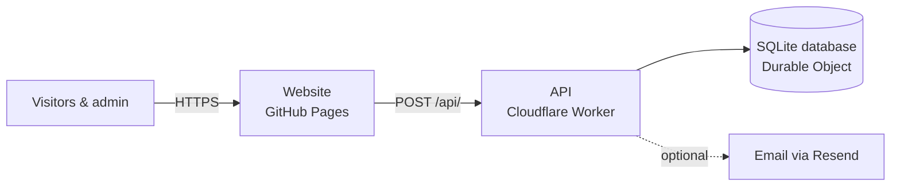

<div align="center">

# EarningHub

**Cashback offers, lead tracking and a full referral programme — with an admin console to run it.**

[](https://github.com/class902/Earninghub/actions/workflows/deploy.yml)
[](https://github.com/class902/Earninghub/actions/workflows/ci.yml)

[Live site](https://class902.github.io/Earninghub/) · [Setup & deployment](docs/DEPLOYMENT.md) · [Architecture](docs/ARCHITECTURE.md) · [Data model](docs/DATA_MODEL.md)

</div>

---

## What it does

| For visitors | For referrers | For the admin |
|---|---|---|
| Browse live cashback offers by category | Generate a personal referral link per offer | Create, order, expire and archive offers |
| Submit a lead through a configurable form | Share it and track clicks, leads and earnings | Review and update leads, remarks and payouts |
| Track a lead's status with a UPI ID | Follow every referral through cashback → reward → payment | Referral command centre: funnel, metrics, link lifecycle, audit trail |
| Use standalone cashback forms | | Analytics, reports, backups & restore, trash, UI builder, link health tester |

## Architecture at a glance



Everything lives in this repository and is deployed by GitHub Actions: the **website** (React + Vite) to GitHub Pages and the **API** (66 typed endpoints + SQLite database) to Cloudflare's free tier.

## Quick start (local development)

```bash
git clone https://github.com/class902/Earninghub.git && cd Earninghub
nvm use                       # Node 22
npm ci
cp apps/worker/.dev.vars.example apps/worker/.dev.vars   # local admin password & secrets
npm run dev:api               # API   → http://localhost:8787
VITE_API_URL=http://localhost:8787 npm run dev   # site → http://localhost:8080
```

| Command | Purpose |
|---|---|
| `npm run dev` / `npm run dev:api` | Website / API dev servers |
| `npm run typecheck` | Type-check website and API |
| `npm run build:pages` | Production website build (needs `API_URL`) |
| `npm run gen:registry` | Regenerate the endpoint registry after adding/removing an endpoint |
| `npm run check:api -- --api <url>` | Smoke-test a deployed API |

## Deploying

Push to `main` — the **Deploy** workflow typechecks, scans for secrets, deploys the API, builds the site against it and publishes to GitHub Pages. One-time setup (Cloudflare account, five GitHub secrets, Pages source) is in **[docs/DEPLOYMENT.md](docs/DEPLOYMENT.md)**.

## Repository layout

```text
.
├── apps/
│   ├── web/                 # React website
│   │   └── src/api/         #   API endpoints (one file each; server code, bundled by the worker)
│   └── worker/              # Cloudflare Worker: router, database layer, auth, email, uploads
├── packages/components/     # shared UI primitives
├── scripts/                 # build, endpoint registry, secret scan, API smoke test
├── docs/                    # deployment, architecture, data model
└── .github/                 # CI, deploy workflow, templates, Dependabot
```

## Security

Admin sessions are signed, expiring tokens; secrets are never committed (CI blocks it). See [SECURITY.md](SECURITY.md).

## License

Proprietary — © EarningHub. All rights reserved.
