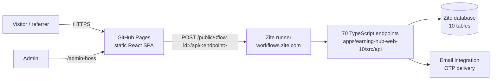

# Architecture

EarningHub is a single-page React application backed by typed server endpoints and a managed database on the **Zite** platform.

## Layers

| Layer | Location | Notes |
|---|---|---|
| Frontend | `apps/earning-hub-web-10/src` | React 18, Vite, Tailwind, Radix/shadcn UI, TanStack Query, React Router. Pages are lazy-loaded. |
| Backend endpoints | `apps/earning-hub-web-10/src/api` | One file per endpoint (`createEndpoint` + Zod input/output schemas). 51 admin endpoints and 19 public / user-facing endpoints. |
| Shared UI | `packages/components` | shadcn/ui primitives, theme switcher, markdown editor. |
| Database client | `.zite/db.ts` | Generated, typed access to the tables in [DATA_MODEL.md](DATA_MODEL.md). |
| Hosting glue | `scripts/`, `.github/workflows/` | Static build, SPA fallback, CI/CD, smoke test. |

## Routes

| Path | Purpose |
|---|---|
| `/` · `/offers` | Home, live offers |
| `/:slug` · `/offer/:slug` | Offer detail and lead form |
| `/exclusive/:slug` | Private campaign |
| `/forms` · `/form/:slug` | Cashback forms |
| `/user-lead-track` | Lead tracker for users |
| `/refer` · `/refer-generate/:slug` · `/refer/:code` · `/offereftrck/:code` | Referral hub, link generator, landing and tracker |
| `/admin-boss` | Admin panel (offers, leads, referrals, analytics, backups, settings) |

## Static hosting model

GitHub Pages only serves static files, so the repository deploys the **frontend**; the **backend stays on Zite**. The build:

1. is compiled with `VITE_BASE_PATH` (sub-path or domain root) and `VITE_ZITE_RUNNER_URL` baked in;
2. copies `index.html` to `404.html` so deep links such as `/offer/<slug>` load the app shell on a static host;
3. runs a secret scan over the output before publishing.

All shareable links the app generates (referral links, tracker links, offer links) go through `src/lib/appUrl.ts` so they stay correct under a sub-path.

## Admin authentication

Admin endpoints require the server-side `ZITE_ADMIN_PASSWORD` environment variable (shared helper `src/lib/adminAuth.ts`). If it is not configured the endpoints refuse every request — there is no built-in default.
