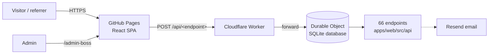

# Architecture

EarningHub is a single-page React website talking to a small API. Both are deployed from this repository.

## Components

| Layer | Location | Notes |
|---|---|---|
| Website | `apps/web/src` | React 18, Vite, Tailwind, Radix/shadcn UI, TanStack Query, React Router. Pages are lazy-loaded. |
| Endpoints | `apps/web/src/api` | One file per endpoint: Zod input schema + `execute`. 47 admin endpoints, the rest public. They live next to the website so it can import their types. |
| API runtime | `apps/worker/src/runtime` | `createEndpoint`, error codes, SQLite table client (`db`), admin auth, email. |
| Router | `apps/worker/src/handler.ts` | `POST /api/<name>`, `POST /upload`, `GET /files/<id>`, `GET /api/health`. |
| Database | `apps/worker/src/database.ts`, `db/schema.ts` | One SQLite-backed Durable Object. Tables are created/extended automatically from `schema.ts` on start. |
| Typed client | `apps/web/src/lib/api.ts`, `caller.ts` | Types are inferred from the endpoint files. |

## Request flow

1. The browser calls `POST {API_URL}/api/<endpoint>` with `{ "inputs": { … } }`.
2. The Worker answers CORS (allowed origins only) and forwards to the Durable Object.
3. The router validates the input with the endpoint's Zod schema, checks the admin session if the endpoint takes one, and runs `execute`.
4. Errors map to HTTP status codes (`400` invalid input, `401` unauthenticated, `404`, `429` rate limited, `500`).

## Admin authentication

- `adminLogin` checks the Admin ID and password (stored credentials, else the `ADMIN_PASSWORD` secret) and returns an HMAC-signed session token that expires after 12 hours (`SESSION_SECRET`).
- The website sends that token with every admin call. The router verifies the signature and expiry before any admin endpoint runs; the raw password is never reused as a token.
- Login is limited to 10 failed attempts per IP per 15 minutes.

## Data & files

- All records live in SQLite tables defined in [`schema.ts`](../apps/worker/src/db/schema.ts) (see [DATA_MODEL.md](DATA_MODEL.md)).
- Uploaded images/PDFs (max 1.5 MB, images are shrunk in the browser first) are stored in the same database and served from `/files/<id>`.
- The admin **Backup** page exports a full JSON snapshot you can restore at any time.

## Hosting model

The website is a static build (`VITE_API_URL`, `VITE_BASE_PATH` baked in) with a `404.html` fallback so deep links work on GitHub Pages. All generated links go through `src/lib/appUrl.ts`, so they stay correct under a sub-path.
